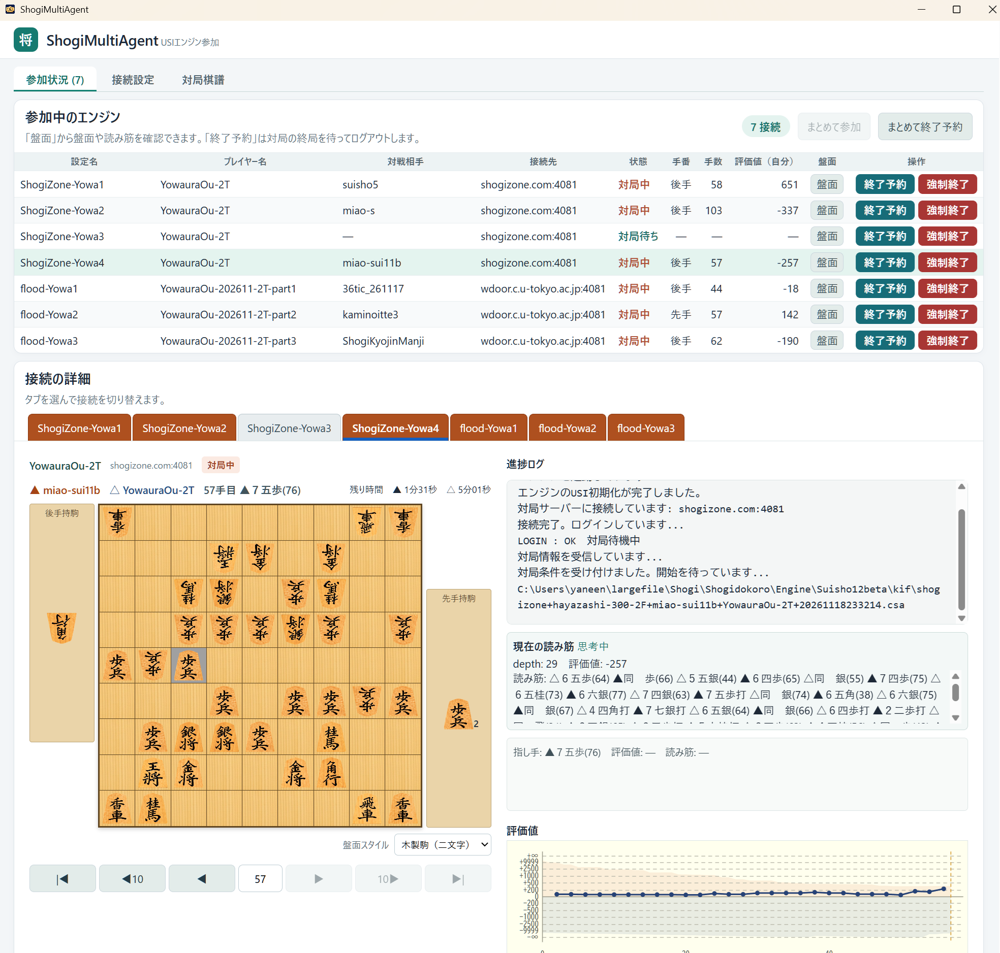
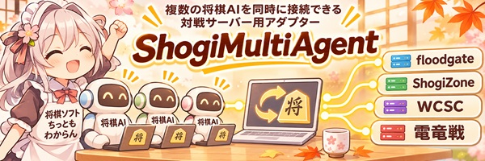

# ShogiMultiAgent

Windows x64で、USIエンジンをShogiZoneやfloodgateなどのCSA対局サーバーに参加させるアプリです。複数のエンジンを同時に参加させ、それぞれの状態や盤面、評価値、読み筋を確認できます。探索中の読み筋は新しい情報から順に表示します。

**[初心者向けチュートリアルを始める](docs/tutorial.md)** — 準備から接続設定、対局、棋譜の確認まで、順を追って説明します。ソースからのビルド方法も掲載しています。

開発者向けの構成・仕様・検証方法は [spec/](spec/README.md) を参照してください。

## アプリバナー

アプリバナーです。ご自由にお使いください。

